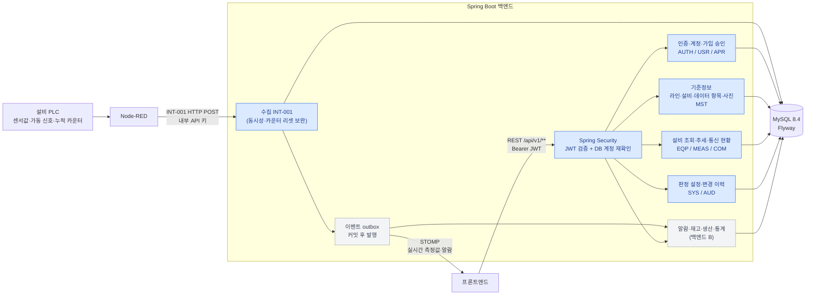
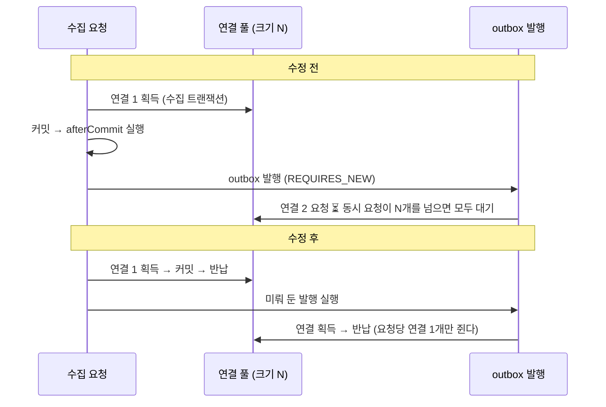
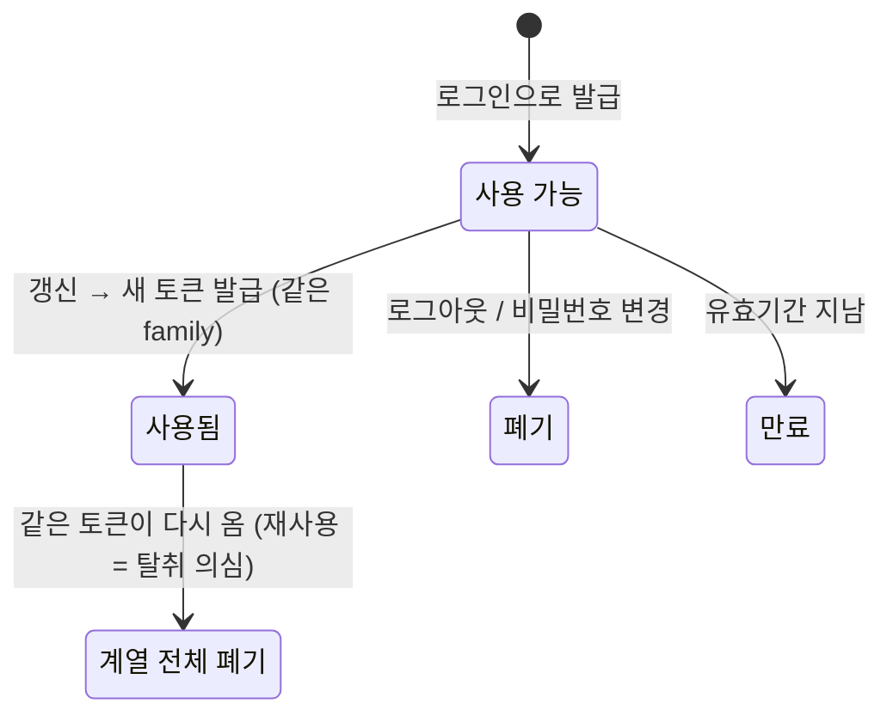

# SFaaS: 스마트팩토리 설비 모니터링 백엔드

> 조립 라인 설비의 PLC 데이터를 실시간으로 받아 설비 상태·알람·생산량·재고 소진 시점을 보여 주는 Spring Boot 백엔드
> **백엔드 A 담당**: 인증·계정·기준정보·설비 조회, 설비 데이터 수집 안정화
>
> 실행 방법은 [docs/PROJECT_SETUP.md](docs/PROJECT_SETUP.md), API 계약은 [docs/openapi.yaml](docs/openapi.yaml)을 참고한다.


## 목차

1. [프로젝트 개요](#1-프로젝트-개요)
2. [아키텍처](#2-아키텍처)
3. [담당 기능](#3-담당-기능)
4. [트러블슈팅](#4-트러블슈팅)
5. [설계와 구현](#5-설계와-구현)
6. [테스트와 협업 방식](#6-테스트와-협업-방식)
7. [회고](#7-회고)

---

## 1. 프로젝트 개요

| 항목 | 내용 |
|---|---|
| 기간 | 2026-11-11 ~ 2026-11-24 |
| 팀 | 5명 (백엔드 2, 프론트 1, DB 2) |
| 내 역할 | 백엔드 A |
| 담당 범위 | 전체 API 68개 중 **42개 소유**, 이 중 **36개 직접 구현**<br/>(EQP-001·SYS-001~004·INT-001은 백엔드 B가 먼저 만들고 내가 보완) |
| 기여 | 머지된 PR **20건** (팀 전체 175건), 커밋 **27건** (머지 커밋 제외, 팀 전체 233건) |

**기술 스택**

| 분류 | 사용 기술 |
|---|---|
| Backend | Java 21, Spring Boot 4.1, Spring Security (OAuth2 Resource Server, JWT), Spring Data JPA, JDBC |
| Data | MySQL 8.4, Flyway (V1~V14) |
| 실시간·수집 | WebSocket (STOMP), Node-RED (MQTT → HTTP) |
| 문서·테스트 | springdoc-openapi, JUnit 5 |
| Infra | Docker Compose, GitHub Actions (MySQL 8.4 서비스 컨테이너) |
| 협업 | Jira, Confluence, GitHub PR |

---

## 2. 아키텍처

> 🟦 내가 만들거나 보완한 부분 · ⬜ 백엔드 B 담당



1. Node-RED가 PLC 값을 모아 INT-001로 보낸다. 서버는 측정값과 생산량을 저장하고, 커밋이 끝나면 이벤트를 발행한다.
2. 발행된 이벤트를 받아 알람을 판정하고, STOMP로 프론트에 실시간 전송한다.
3. 프론트의 REST 요청은 JWT를 검증한 뒤, 요청마다 DB에서 계정 상태와 권한을 다시 확인하고 처리한다.

---

## 3. 담당 기능

| 영역 | API | 내용 |
|---|---|---|
| 인증 | AUTH-001~006 | 로그인, 토큰 갱신(회전), 로그아웃, 내 정보, 회원가입 신청, 비밀번호 변경 |
| 계정 | USR-001~005, APR-001~003 | 계정 관리, 비밀번호 초기화, 가입 승인·거절 |
| 기준정보 | MST-001~013, MST-018 | 라인·설비·배치·데이터 항목·알람 기준, 설비 사진 |
| 조회 | EQP-002~005, MEAS-001, COM-001~002 | 공정·설비 현황, 측정값 추세, 통신 상태 |
| 설정 | SYS-001~004 (보완), AUD-001 | 판정 설정 검증, 설정 변경 이력 |
| 수집 | INT-001 (보완) | Node-RED 수집 API의 동시성·카운터 리셋 문제 해결 |

---

## 4. 트러블슈팅

| # | 문제 | 해결 | 결과 |
|---|---|---|---|
| 4.1 | 설비 27대가 동시에 보내면 DB 연결 풀이 막힘 | 커밋 후 발행을 연결 반납 뒤로 미룸 | 동시 8건 중 6건 실패 → **0건 실패** |
| 4.2 | PLC를 재시작하면 설비가 통신 끊김으로 보임 | 줄어든 카운터를 거절하지 않고 새 기준점으로 처리 | 센서·가동 데이터 유실 없음 |
| 4.3 | 동시 등록에서 409 대신 500 | 실패한 세션에서 다시 조회하지 않고 SQL 오류 코드로 판별 | 실제 MySQL CI 통과 |

### 4.1 동시 수집에서 DB 연결 풀 교착

**문제**
통합 점검에서 설비 27대가 동시에 데이터를 보냈다. 수집 API가 30초 동안 응답하지 못하다가 500을 반환했다. 이때 Hikari 연결 풀은 `active=10, idle=0, waiting=202`였다.

**원인**
- 수집 트랜잭션이 커밋된 뒤 `afterCommit` 콜백에서 이벤트 outbox를 `REQUIRES_NEW`로 발행했다. 이때 두 번째 DB 연결이 열렸다.
- Spring은 `afterCommit`이 끝난 **뒤에** 첫 연결을 반납한다. 그래서 요청 하나가 연결 2개를 동시에 쥐었다.
- 동시 요청 수가 풀 크기를 넘었다. 모든 요청이 첫 연결을 쥔 채 두 번째 연결을 기다리면서 풀 전체가 멈췄다.



**해결**
- `AfterTransactionDispatch`를 만들었다. 커밋 후 발행 작업을 모아 두었다가, **연결을 반납한 다음** 같은 스레드에서 실행한다.
- 기존 `BEventPublisher`는 이 작업 단위 안에서는 발행을 미루고, 밖에서는 예전처럼 바로 실행한다. 다른 코드의 동작은 바뀌지 않는다.

<details>
<summary>코드 보기</summary>

```java
// AfterTransactionDispatch.java
private static final ThreadLocal<Deque<Runnable>> PENDING = new ThreadLocal<>();

/** 바깥 작업이 있으면 미루고 true, 없으면 false(호출한 쪽이 바로 실행한다). */
static boolean defer(Runnable dispatch) {
    Deque<Runnable> pending = PENDING.get();
    if (pending == null) return false;
    pending.addLast(dispatch);
    return true;
}

public static <T> T around(Supplier<T> work) {
    if (PENDING.get() != null) return work.get();   // 이미 바깥 작업 안이면 합류
    Deque<Runnable> pending = new ArrayDeque<>();
    PENDING.set(pending);
    try {
        return work.get();                          // 트랜잭션 실행 → 커밋 → 연결 반납
    } finally {
        PENDING.remove();
        while (!pending.isEmpty()) {
            try {
                pending.pollFirst().run();          // 연결을 반납한 뒤에 outbox 발행
            } catch (RuntimeException failure) {
                log.error("Deferred post-commit event delivery failed"); // 실패하면 outbox가 재시도
            }
        }
    }
}
```

```diff
// BEventPublisher.afterCommit
- else outbox.dispatch(pendingId);
+ else if (!AfterTransactionDispatch.defer(() -> outbox.dispatch(pendingId)))
+     outbox.dispatch(pendingId);
```

</details>

**검증**: `IngestionConcurrencyTest`에서 연결 풀을 2개로 줄이고 설비 8대를 동시에 수집시켰다.
- 수정 전: `[202, 500, 500, 500, 500, 202, 500, 500]`
- 수정 후: 8건 모두 202, 이벤트 발행 완료

> 💡 트랜잭션 동기화 콜백 안에서 새 트랜잭션을 열 때는 연결이 언제 반납되는지 확인해야 한다. 그리고 동시성 버그는 풀 크기를 일부러 줄여야 테스트로 재현된다.

### 4.2 PLC 재시작 뒤 설비가 "통신 끊김"으로 보이던 문제

**문제**
낮 시간에 PLC나 Node-RED가 재시작되면 해당 설비가 계속 **통신 끊김**으로 보였다.

**원인**
- 생산량은 PLC의 누적 카운터(`prod_count`) 차이로 계산한다.
- 초기화 시각이 아닌데 카운터가 줄면 예외가 발생해 메시지 전체가 400으로 버려졌다.
- 같은 메시지에 있던 가동 신호와 센서 값까지 저장되지 않았다. 그래서 카운터가 예전 값을 넘을 때까지 설비가 "데이터 없음"으로 판정됐다.

**해결**
- 줄어든 카운터를 **새 기준점**으로 삼고, 그 시점의 생산량은 0으로 기록한다. 상태는 `COUNTER_RESET_PENDING`으로 남겨 추적할 수 있게 했다.
- 다음 값부터는 새 기준점에서 늘어난 만큼만 더한다. 명세 규칙("카운터 리셋은 생산으로 합산하지 않는다")은 그대로 지킨다.
- 이 정책 변경은 API 명세에도 기록했다.

<details>
<summary>코드 보기</summary>

```diff
// ProductionCounterService.java
  if (current.compareTo(previous) >= 0) {
      return current.subtract(previous).intValueExact();   // 정상: 늘어난 만큼 생산량
  }
- throw new IllegalArgumentException("Production counter decreased outside its configured reset time");
+ // 초기화 시각 밖에서 줄어든 카운터는 PLC·Node-RED 재시작이다.
+ // 메시지 전체를 거절하면 같은 묶음의 가동 신호·센서 값까지 버려지므로,
+ // 새 기준점으로 보고 생산량 0을 돌려준다. 저장 쪽이 COUNTER_RESET_PENDING으로 남긴다.
+ return 0;
```

</details>

**검증**: `IngestionCounterResetTest`에서 실제 수집 API로 카운터 50 → 3 → 5를 보냈다. 응답은 202였고, 센서 값이 저장됐고, 생산량은 0 다음에 +2가 기록됐다.

> 💡 현장 장비는 언제든 재시작된다. 값 하나가 이상하다고 메시지 전체를 버리면 더 큰 장애로 번진다.

### 4.3 동시 등록에서 409 대신 500 (Hibernate 세션 오염)

**문제**
같은 이름의 라인이나 같은 코드의 설비를 동시에 등록하면 `409 중복` 대신 `500`이 났다. 실제 MySQL로 도는 CI 테스트도 실패했다.

**원인**
- 저장이 실패하면 `existsByName`으로 다시 조회해 중복인지 확인했다.
- 그런데 flush가 실패한 Hibernate 세션에서 다시 조회하면 `AssertionFailure`가 발생한다.
- H2 단위 테스트에서는 드러나지 않았고, 실제 MySQL에서만 나타났다.

**해결**
실패한 뒤에는 다시 조회하지 않는다. 대신 예외의 원인인 `SQLException`의 코드(MySQL 1062, H2 23505)로 중복을 판별한다. 길이 초과처럼 다른 DB 오류는 숨기지 않고 그대로 던진다.

<details>
<summary>코드 보기</summary>

```diff
// MasterLineService.java
  try {
      line = lines.saveAndFlush(LineEntity.create(name, type, order, now()));
  } catch (DataIntegrityViolationException raced) {
-     if (lines.existsByName(name)) {                       // 실패한 세션에서 다시 조회 → AssertionFailure
+     if (UniqueViolations.isUniqueViolation(raced)) {      // 다시 조회하지 않고 예외만 본다
          throw duplicateName();                            // 409
      }
      throw raced;                                          // 다른 DB 오류는 숨기지 않는다
  }
```

```java
// UniqueViolations.java
public static boolean isUniqueViolation(DataIntegrityViolationException ex) {
    for (Throwable cause = ex; cause != null; cause = cause.getCause()) {
        if (cause instanceof SQLException sql && sql.getSQLState() != null) {
            if (sql.getErrorCode() == 1062 || "23505".equals(sql.getSQLState())) {
                return true;                     // MySQL 1062 / H2 23505 = UNIQUE 위반
            }
            if (!sql.getSQLState().startsWith("23")) {
                return false;                    // 무결성 위반이 아닌 다른 오류
            }
        }
        if (cause.getCause() == cause) break;
    }
    return false;
}
```

</details>

> 💡 H2 테스트만으로는 부족했다. 실제 DB로 도는 CI가 있었기 때문에 이 버그를 잡았다. 그리고 영속성 컨텍스트는 예외가 난 뒤에 재사용하면 안 된다.

---

## 5. 설계와 구현

### 5.1 인증: Refresh Token 회전과 재사용 감지

목표는 두 가지였다. 관리자가 승인한 계정만 로그인할 수 있어야 하고, 토큰이 탈취돼도 피해가 커지지 않아야 한다.

| 항목 | 설계 |
|---|---|
| Access Token | 짧은 수명의 JWT. 프론트는 메모리에만 보관한다 |
| Refresh Token | HttpOnly 쿠키로만 내려 준다. 갱신할 때마다 새 토큰으로 바꾸고(회전), DB에는 **해시만** 저장한다 |
| 재사용 감지 | 이미 쓴 토큰이 다시 오면 탈취로 보고 그 토큰 계열(`family_id`) 전체를 폐기한다 |
| 동시 갱신 | 토큰 행을 `PESSIMISTIC_WRITE`로 잠가 한 요청만 성공하게 한다 |
| 로그아웃·비밀번호 변경 | 폐기한 Access Token은 **남은 유효시간만큼만** 보관한다(처음엔 Redis, 2026-11-21에 MySQL 만료 상태 테이블로 이전). 비밀번호를 바꾸면 모든 세션을 폐기한다 |
| fail-closed | 서명이 맞아도 요청마다 DB에서 계정 상태와 권한을 다시 확인한다 |
| 가입 승인 | 행을 잠그고 처리한다. 변경 이력을 같은 트랜잭션에 기록해서, 기록에 실패하면 승인도 롤백된다 |



<details>
<summary>코드 보기</summary>

```java
// DatabaseSessionStore.rotate
// 토큰 행을 PESSIMISTIC_WRITE로 잠가서 읽는다. 같은 토큰으로 동시에 갱신해도 한 요청만 성공한다.
AuthTokenEntity current = tokens.findForRotation(oldHash).orElse(null);
if (current == null || current.getRevokedAt() != null) {
    return new Rotation(RotationStatus.INVALID, null, null);
}
if (current.getUsedAt() != null) {
    // 이미 새 토큰으로 바뀐 토큰이 다시 왔다. 탈취 가능성이 있으므로 호출자가 계열 전체를 폐기한다.
    return new Rotation(RotationStatus.REUSED, current.getAccountId(), current.getFamilyId());
}
if (!current.getExpiresAt().isAfter(nowLocal)) {
    return new Rotation(RotationStatus.INVALID, null, null);
}
current.markUsed(nowLocal);
tokens.save(new AuthTokenEntity(current.getAccountId(), current.getFamilyId(), nextHash,
        nowLocal, KstTime.toLocal(nextExpiresAt)));
return new Rotation(RotationStatus.ROTATED, current.getAccountId(), current.getFamilyId());
```

```java
// AuthFlowService.refresh: 재사용이면 계열 전체 폐기
if (rotation.status() == SessionStore.RotationStatus.REUSED) {
    if (rotation.familyId() != null) sessions.revokeFamily(rotation.familyId());
    throw invalidRefresh();
}
```

</details>

**검증**: 인증 PR 2건에서 테스트 136개를 추가했다. 임시 MySQL 8.4와 Redis(당시 구성)로 회전, 재사용 감지, 동시 갱신, 로그아웃, 비밀번호 변경 흐름을 확인했다.

> 💡 JWT 발급 시각은 초 단위다. 그래서 비밀번호를 바꾼 그 초에 발급된 토큰도 폐기되게 했다. 애매할 때는 안전한 쪽으로 판정한다.

### 5.2 `` 태그로 인증이 필요한 설비 사진 보여 주기

**문제**
설비 사진은 로그인한 사용자만 봐야 한다. 그런데 `` 태그는 `Authorization` 헤더를 보낼 수 없다.

**해결**: 10분 동안만 유효한 HMAC-SHA256 서명 URL을 쓴다.

```
/api/v1/equipment-photos/{fileName}?expires=1795000000&signature=...
```

- 서명 키는 JWT 키에 용도 문자열을 붙여 따로 만든다. 같은 키를 두 용도에 그대로 쓰지 않기 위해서다.
- 서명은 `MessageDigest.isEqual`로 비교한다. 비교 시간이 일정해서 타이밍 공격을 막을 수 있다.
- 서명에 파일 이름과 만료 시각이 같이 들어간다. 다른 사진으로 바꾸거나 만료 시각을 늘리면 서명이 맞지 않는다.
- JPG·PNG·WebP만 받고, 최대 5MB로 제한했다.

<details>
<summary>코드 보기</summary>

```java
// EquipmentPhotoUrlSigner.java
public EquipmentPhotoUrlSigner(@Value("${app.jwt.secret}") String secret) {
    // JWT 키를 그대로 쓰지 않고, 용도 문자열을 붙여 사진 전용 키를 따로 만든다
    byte[] derived = MessageDigest.getInstance("SHA-256")
            .digest(("stf-equipment-photo-url:" + secret).getBytes(StandardCharsets.UTF_8));
    this.key = new SecretKeySpec(derived, "HmacSHA256");
}

public String url(String fileName, Instant now) {
    long expires = now.plus(Duration.ofMinutes(10)).getEpochSecond();
    return "/api/v1/equipment-photos/" + fileName
            + "?expires=" + expires + "&signature=" + sign(fileName, expires);
}

public boolean verify(String fileName, Long expires, String signature, Instant now) {
    if (fileName == null || expires == null || signature == null
            || now.getEpochSecond() > expires) {
        return false;                                   // 값이 없거나 10분이 지나면 거절
    }
    return MessageDigest.isEqual(                       // 비교 시간이 일정한 비교 (타이밍 공격 방지)
            sign(fileName, expires).getBytes(StandardCharsets.US_ASCII),
            signature.getBytes(StandardCharsets.US_ASCII));
}
```

</details>

### 5.3 계약 우선 개발: 명세와 코드를 테스트로 묶기

**배경**
요구사항이 바뀌면서 API 명세가 v5에서 v7로 개정됐다. 권한 모델(직책 3종 → ADMIN/USER), 알람 상태, 삭제된 API가 달라졌다. 백엔드 2명과 프론트는 같은 `openapi.yaml`을 기준으로 개발했다.

**한 일**
- 계약을 바꿀 때는 `API_SPEC.md`, `openapi.yaml`, 코드, 테스트를 **같은 커밋**에서 고쳤다.
- 서버가 실제로 내는 오류 코드 34개가 명세에 모두 있는지 검사하는 테스트를 만들었다. 이 테스트로 이미 어긋나 있던 코드 1건을 찾았다(`SETTING_VALUE_OUT_OF_RANGE` → `SETTING_OUT_OF_RANGE`).
- 입력 길이 검증을 ERD 칼럼 길이에 맞췄다. 그래서 DB 오류 대신 400 응답이 나간다.
- 프론트 요청(공정 대표 상태 우선순위, 공정별 조회 조건)은 명세에 결정 이유를 먼저 남기고 구현했다.

<details>
<summary>코드 보기</summary>

```java
// OpenApiErrorCodeContractTest.java (줄임)
@Test
void everyServerErrorCodeIsInTheContract() throws IOException {
    Set<String> enumCodes = new TreeSet<>(errorCodeEnum());      // openapi.yaml의 ErrorDetail.code enum
    Set<String> used = new TreeSet<>();
    try (Stream<Path> files = Files.walk(Path.of("src/main/java"))) {
        for (Path file : files.filter(p -> p.toString().endsWith(".java")).toList()) {
            String source = Files.readString(file);
            for (Pattern site : CODE_SITES) {                    // new DomainException(..., "CODE") 같은 호출
                Matcher m = site.matcher(source);
                while (m.find()) used.add(m.group(1));
            }
        }
    }
    used.removeAll(LEGACY_V5);                                   // v5에만 있던 기능의 코드는 제외
    assertThat(enumCodes)
        .as("서버가 내는 오류코드는 ErrorDetail.code enum 에 있어야 한다")
        .containsAll(used);
}
```

</details>

> 💡 누가 새 오류 코드를 추가하고 명세에 적지 않으면 CI가 실패한다. 프론트가 모르는 오류 코드가 나가는 일을 테스트로 막았다.

---

## 6. 테스트와 협업 방식

- **테스트**: 최종본 기준 팀 전체 567개 (테스트 클래스 101개). 동시성·롤백·실제 MySQL 테스트를 포함한다.
- **CI**: GitHub Actions에서 MySQL 8.4 서비스 컨테이너를 띄워 PR마다 전체 테스트를 실행한다.
- **작업 단위**: Jira 이슈(API ID 단위) → feature 브랜치 → PR → 리뷰 후 머지
- **기록**: API별 커밋·PR·테스트를 작업 기록 문서로 정리했다. 계약을 바꾸는 결정은 명세의 결정 기록 장에 남겼다.

---

## 7. 회고

- **잘한 점**: 통합 점검에서 나온 장애 두 건(4.1, 4.2)을 재현 테스트부터 만들고 고쳤다. 이 테스트들은 최종본에도 회귀 테스트로 남아 있다.
- **잘한 점**: 명세를 계약 원본으로 두고 오류 코드까지 테스트로 묶어, 프론트와 백엔드 B가 같은 기준으로 개발할 수 있었다.
- **아쉬운 점**: [ ]
- **다음에 해 볼 것**: [ ]

---

## 링크

- 원본 저장소: [balkary/SFAAS_Project](https://github.com/balkary/SFAAS_Project) (비공개)
- API 문서 (Swagger UI): https://chdevj.github.io/SFaaS-Backend/swagger/ (팀 레포 최종본 명세 v7.0.0, 읽기 전용)
- 시연 영상: [YouTube](https://www.youtube.com/watch?v=QaAxkNaUPLw)
